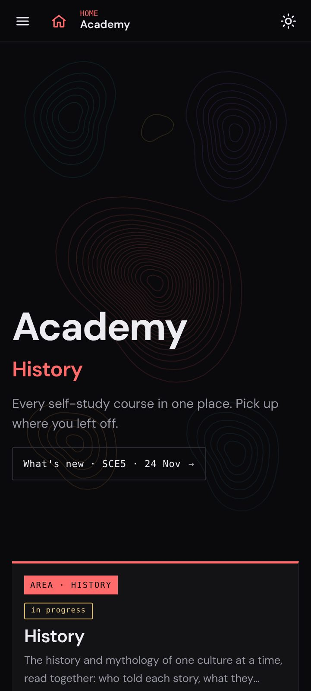
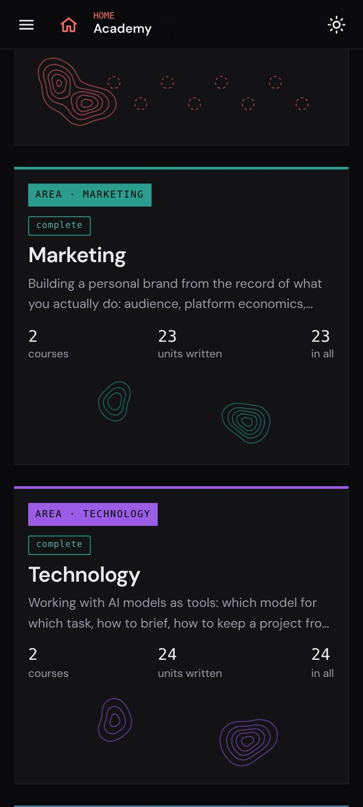
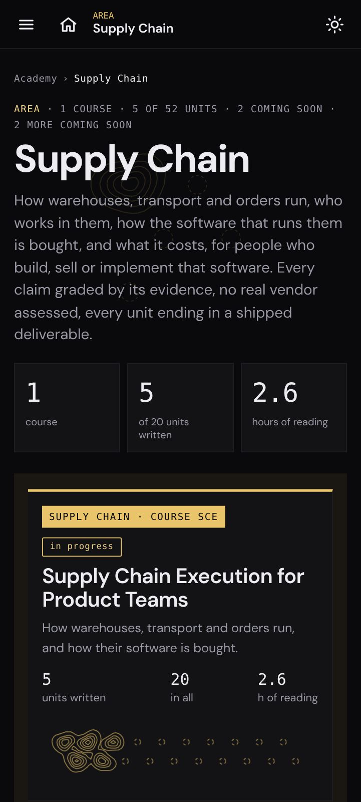
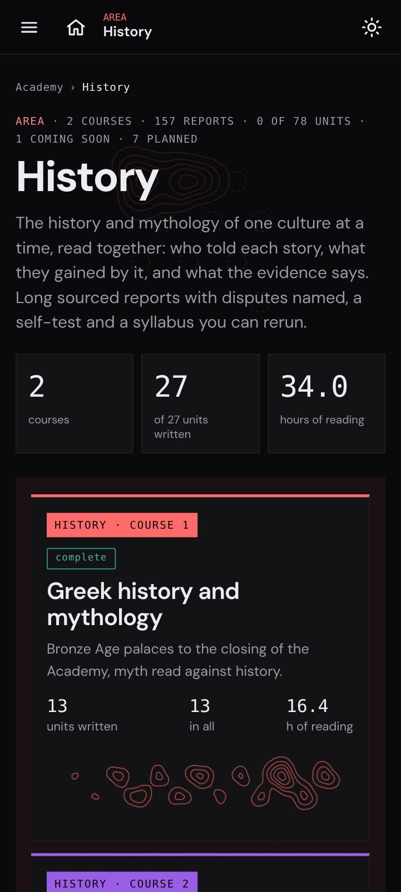

## Problem

I learn by reading long, in order, on my phone, and I check the citations. Off-the-shelf courses are built for an average student: they repeat what I know, skip what I need, and rarely show their sources.

I wanted **depth on the subjects I chose, aimed at my gaps.** Ancient history for its own sake. Personal brand and AI because I was building in public. Supply chain execution because I design software for it and wanted the operational ground under my feet.

A chatbot will write a lesson on anything. It will also invent a citation, forget what the last lesson said, and drift. **The product is the system that prevents those three things.**

## Strategy

By late October I had two separate efforts: a history kit with Greece complete and Rome under way, and a brand and AI course in its own hub. I asked for a status review. It found the two contradicted each other: a design fix never applied to the live site, two competing audit schedules, and documents pointing at tools that did not exist.

I answered five decisions. **The same day there was one repo, one written method, and one site called Academy, published and deployed.**

### The rules I set

- **One reader, defined once.** A profile the writers get and may not add to.
- **A brief is a contract.** Units are written from the brief as approved. No model rewords one.
- **Every unit ends in something usable,** built in full: a document, a model, a plan. History reports end with a ten-question self-test and three ideas to carry forward.
- **Opened before cited.** A source that could not be opened carries no claim. An unsourced claim says so or is left out.
- **Disagreement is shown.** Where scholars or sources differ, each side is named.
- **One theme file.** No page gets its own styling. The same files make the site and an ebook.

```diagram
search-flag
```

## Product






| Area | Courses | Written |
|---|---|---|
| History | Greece, Rome. Egypt designed | 157 reports |
| Marketing | Personal brand, and a public version | 23 units |
| Technology | Building with AI, and a public version | 24 units |
| User Experience | Information architecture, for other designers | 15 units |
| Sports | Sport psychology for coaches. Athlete careers designed | 13 units |
| Supply Chain | Execution in progress. Planning and AI designed | 7 of 52 units |

```diagram
ia
```

### From private tool to public product

The first courses were written for me. Once they worked I had them rebuilt as **public versions for other readers**, then designed new ones for audiences I know: coaches of young athletes, and product teams in supply chain software. Each public course names its own reader in its briefs.

## Quality

The quality system was not designed up front. **Each rule exists because something failed and I measured it.**

| What happened | The rule it produced |
|---|---|
| History reports written without an independent checker scored 4.28 on the review rubric. With one, 4.8. | A fresh checker for every history report. |
| The first audit of the brand course failed 23 of 91 sampled claims across three units. | The three units were rewritten. From that day every unit of every course gets a checker that never saw it written. |
| In the Rome course, 15 figures were dropped after failing their check three times, mostly on captions that claimed more than the text. | I changed the rule two days later: a figure is fixed and re-checked until it passes. It is never dropped. |
| Units on prices, platform rules and model lineups go stale. | Every such unit carries a search flag and a re-check date six months out. |
| Corrections found late were getting lost. | Carry-forward: anything found goes into the next session's prompt and is fixed first. Nothing is dropped silently. |

```diagram
unit-gate
```

```diagram
carry-forward
```

## Leadership

I changed the rules when the evidence changed, and I kept the calls no check can make.

- **I rejected a shipped page on sight.** Two independent checkers had passed it.
- **I stopped the audits I had asked for** when their cost showed, and kept the cheaper check on every unit.
- **I stopped unit writing for a refactoring,** so the next course would be a folder and not a code change.
- **I turned approval into veto,** so the queue no longer waits on me.

## Orchestration

Before 15 Nov the most capable model audited finished units, and the session chat read everything. Quality was good. **The cost of one audit run was not.** I stopped the expensive audits and split the work by cost.

```diagram
loop
```

- **One chat per unit,** or one isolated agent per unit. Leaked context is how a course starts repeating itself.
- **Nothing happens that is not a backlog row.** Every finished row moves to the changelog with the model that actually ran.
- **I veto. I do not approve.** Proposals are listed, flagged if they disrupt anything, and worked in the next session unless I remove them.
- **Bundles of four.** A course runs in unattended sessions of up to four units from one two-line starter. Each session ends by printing the next.
- **Scripts close the loop:** an index check, a private-terms check, a layout suite across phone, tablet and desktop, and a hash read-back after publishing.

```diagram
system
```

## Planning ahead

- **A course is a folder of Markdown.** Adding one edits no code. I can launch a version with only some courses, or reskin the site without touching content.
- **Content outlives the site.** The same files can become an ebook, an app or audio. No accounts, no tracking, a minimal stack on purpose.
- **Figures are data.** A unit declares a timeline or a comparison. The build draws it from the unit's own sourced numbers.
- **Verify only what changed.** Checks were getting slower with every course. I had the build split so quality holds and the wait does not grow.
- **Several sessions at once.** A landing step with a lock rebases, re-verifies the combined result and only then publishes.

## Where it went wrong

- **A home page that passed every check and failed on sight.** A "bookshelf" with one spine per unit went through two rounds of independent checkers and shipped. I rejected it from a screenshot. I had the AI research hero patterns, interview me, and rebuild it as the contour map that is live now.
- **Twenty-three false or unsupported claims** in the first audit sample. Three units were rewritten.
- **The wrong files handed over.** A package labelled as the latest was one session old. The AI noticed, compared it with the live site and restored the missing record.
- **A unit that failed its check outright.** The first draft of one sport psychology unit came back with four errors and a verdict of rewrite. It was discarded and written again.
- **The wrong model ran, more than once.** A session asked for one model and got another. The rule since: record the model that ran, never the one requested.

> "the spine looks awful, oh god... Such a long scroll in mobile, makes no sense. Let's go back"
> -- me, 4 Nov, on a page two checkers had passed

**What I took from it:** a checker verifies the spec. Whether the spec was worth building is still my call.
